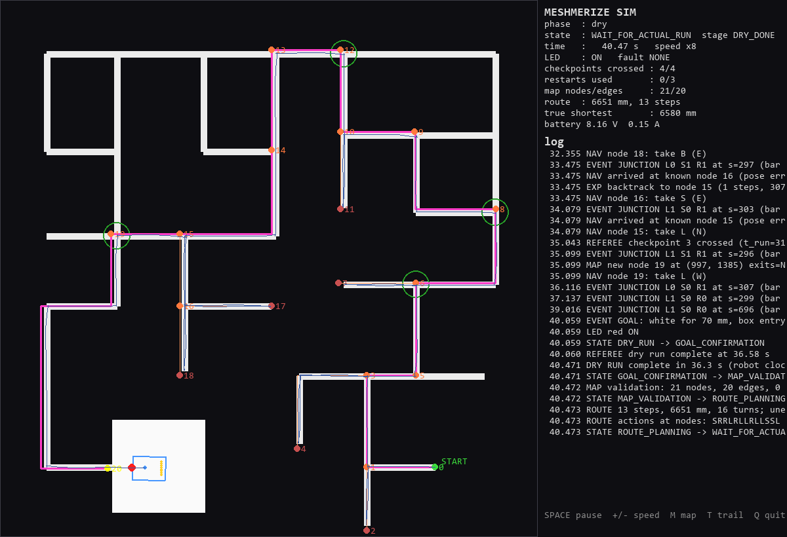

# Meshmerize robot (Techfest IIT Bombay 2026-27)

An autonomous white-line maze robot built around the official problem statement:
**explore** during the dry run, **store** a metric map, then **replay the shortest route** at speed
in the actual run.

| | |
|---|---|
| Controller | ESP32 DevKit V1, 30-pin (radios never started) |
| Sensing | 5-channel digital TCRT5000 array (15 mm pitch) 100 mm ahead of the axle + 2 FC-51 "wing" sensors at ±45 mm; MPU6050 gyro |
| Drive | 2 × BO 500 RPM gear motors **without encoders**, L298N, 65 mm wheels, 2WD chassis kit |
| Power | 4 × 18650 in series (16.8 V) → 3 A fuse → rocker switch → L298N / LM2596 5 V → ESP32 3.3 V |
| Parts | already bought by the team; recommended additions ≈ ₹900 (4S BMS + charger, a few resistors and capacitors): `hardware/bom.csv` |
| Wiring | `docs/Circuit_Diagram.pdf` (schematic, wire-by-wire list, charging and safety) |

The original design (N20 + encoders, Pololu QTR-MD-08A, TB6612, 2S LiPo, printed chassis) is kept
as the parametric CAD and as the simulator preset `n20_hardware()`.



## What is in this repository, and how far it has been verified
| Part | Where | Verified by |
|---|---|---|
| Firmware core: sensing, PD control, gyro heading, speed model or encoders, junction and goal detection, graph mapping, exploration, Dijkstra, persistence, restarts, faults | `firmware/src` | 61 automated tests; closed-loop simulation |
| ESP32 hardware layer + build (L298N / TB6612 / DRV8833) | `firmware/src/hal_esp32`, `firmware/platformio.ini` | **compiles** for ESP32 (`esp32_l298n`: RAM 21.5 %, flash 28.1 %). Not run on hardware. |
| Simulator: arena, physics, sensors, referee, scoring, GUI | `simulator/` | runs; the robot inside it is the firmware core |
| Batch benchmarks + policy study | `tools/`, `results/` | numbers in `results/test_summary.md` |
| Electrical design, BOM, pin map, circuit diagram, power budget | `docs/electrical_design.md`, `docs/Circuit_Diagram.pdf`, `hardware/` | calculations + datasheet values; pin map unit-tested against firmware; diagram generated from the pin table |
| Parametric CAD of the original N20 design | `hardware/cad`, `hardware/*/` | automated geometric checks; not printed; not the robot being built |
| Rules, research, ADRs, guides, checklists | `docs/` | — |

**Nothing has been tested on physical hardware yet.** Simulation results are evidence about
the algorithms, not about the real robot. See `docs/calibration_guide.md` for the bench and arena
validation plan.

## Key results (simulation of the purchased robot, 100 held-out random mazes + the sample arena)
| Metric | No encoders, realistic | No encoders, harsh | Slot encoders, realistic | Slot encoders, harsh |
|---|---|---|---|---|
| Dry-run / actual-run completion | 99 % / 99 % | 93 % / 89 % | 99 % / 99 % | 94 % / 91 % |
| Actual run on the true shortest path | **95 %** | **83 %** | **98 %** | **88 %** |
| Mean score (official formula) | **399** (p10 387) | **363** (p10 233) | **403** (p10 390) | **375** (p10 212) |
| Mean dry run / actual run | 68 s / 8.5 s | 71 s / 8.2 s | 68 s / 7.7 s | 70 s / 8.5 s |
| Restarts · false goals · faults | 4 · 0 · 0 | 20 · 1 · 3 | 1 · 0 · 0 | 19 · 0 · 4 |

Reconstructed sample arena (no encoders, realistic): 4/4 checkpoints, shortest route, dry 73 s, actual 15.2 s, score 406.8.

"Realistic" = motors ±4 % unequal, 3 % speed-model error, gyro bias and noise, sensor noise and threshold spread, slip.
"Harsh" = motors ±10 % unequal, 10 % speed-model error, bigger gyro errors, dull vinyl, more noise and slip.
Slot encoders are an optional ~₹140 upgrade (`hardware/bom.csv` item 22). Full tables, definitions and the
list of failures: `results/test_summary.md`. Results for the original N20 design are archived in
`results/benchmark_results_n20_v1.0.csv`.

## Quick start
```bash
pip install -r requirements.txt
python -m pytest simulator/tests                       # build the core, run all tests
python -m simulator.main                               # watch the robot on the sample arena
python -m simulator.main --arena gen:42 --profile harsh
python tools/run_batch_tests.py --mazes 40 --label try # randomised benchmark
cd firmware && pio run -e esp32_l298n -t upload       # flash the ESP32 (PlatformIO)
python tools/make_wiring_diagram.py                    # regenerate the circuit diagram
```

## Documentation map
| Topic | File |
|---|---|
| **Illustrated guide (PDF)**: how the robot works, building and wiring it, how a match runs | `docs/Meshmerize_Robot_Guide.pdf` (rebuild: `python tools/guide/figures.py && python tools/guide/build_guide.py`) |
| Official rules, scoring, **ambiguities and questions for the organisers** | `docs/competition_rules.md` |
| Requirement → design → evidence | `docs/requirements_traceability.md` |
| Research report (repositories inspected, licences, lessons) | `docs/research_and_repositories.md` |
| Architecture decisions (controller, sensors, motors, algorithms) | `docs/architecture_decisions.md` |
| System architecture, state machine, timing | `docs/system_architecture.md` |
| Electrical design, power tree, driver sizing | `docs/electrical_design.md`, `hardware/power_budget.md` |
| **Circuit diagram** and wiring | `docs/Circuit_Diagram.pdf`, `docs/wiring_and_pinout.md`, `hardware/pin_mapping.csv`, `hardware/wiring_diagram.svg` |
| Bill of materials | `hardware/bom.csv` (= `docs/bill_of_materials.csv`) |
| Mechanical layout (purchased chassis) and the original CAD | `docs/mechanical_design.md`, `hardware/cad/`, `hardware/assembly_drawings/` |
| Mapping, exploration, shortest path | `docs/maze_graph_algorithm.md`, `docs/exploration_strategy.md`, `docs/shortest_path.md` |
| Assembly · calibration and tuning · troubleshooting | `docs/assembly_guide.md`, `docs/calibration_guide.md`, `docs/troubleshooting.md` |
| Testing and results | `docs/testing_and_validation.md`, `results/test_summary.md` |
| Competition-day checklist and compliance | `docs/competition_checklist.md` |
| Firmware build and upload | `firmware/README.md` |
| Simulator | `simulator/README.md` |

## Milestone plan to the competition (from 29 Oct 2026)
| Week | Goal | Exit criterion |
|---|---|---|
| 1 | Send the organiser questions (Q1–Q16, incl. chassis plate and ESP32); buy the recommended additions (4S BMS + charger, resistors, capacitors) | answers requested; charging solved |
| 2 | Assemble and wire (`docs/Circuit_Diagram.pdf`); calibration Phases 0, A, B (gyro, pots, speed model) | junction distances within ±3 % |
| 3 | Phase C (line following, turns) on a taped practice track | 20/20 turns each way |
| 4 | Full-size practice arena (sample layout + 3 variants); Phases D–E | 10/10 dry runs complete; route = true shortest; 0 false goals |
| 5 | Phase F (speed ramp), Phase G (robustness, restarts, jam test, battery levels) | 10 clean matches in a row at competition settings |
| 6 | Freeze firmware; spares; rehearse the competition checklist | 3 full rehearsal matches within 5:30 |

## Next physical actions (in priority order)
1. Ask the organisers: is the purchased chassis plate a "ready-made mechanism"? Is an ESP32 allowed
   with its radios off? Plus the questions in `docs/competition_rules.md` §9 (**Q4** and **Q3** change the strategy).
2. Solve charging: the TP4056 charges one cell only. Buy a 4S BMS + 16.8 V charger, or charge cells
   one by one (`docs/Circuit_Diagram.pdf` page 3).
3. Fit the cheap upgrades if at all possible: the 47k/10k battery divider (largest effect in
   simulation), 330 Ω for the LED, 470 µF across the L298N.
4. Assemble (`docs/assembly_guide.md`), wire (`docs/Circuit_Diagram.pdf`), do the multimeter checks.
5. Flash `esp32_l298n_debug` and work through `docs/calibration_guide.md` Phases 0, A, B. Enter the
   measured sensor positions, track width and speed-model values in `config.h`.
6. Lay out a full-size 230 × 230 cm practice arena: matte black sheet, 30 mm white vinyl tape,
   400 × 400 mm white box.
7. Phases C–G. Compare every real run's log with the simulator on the same layout
   (`simulator/examples/sample_arena.json`).
