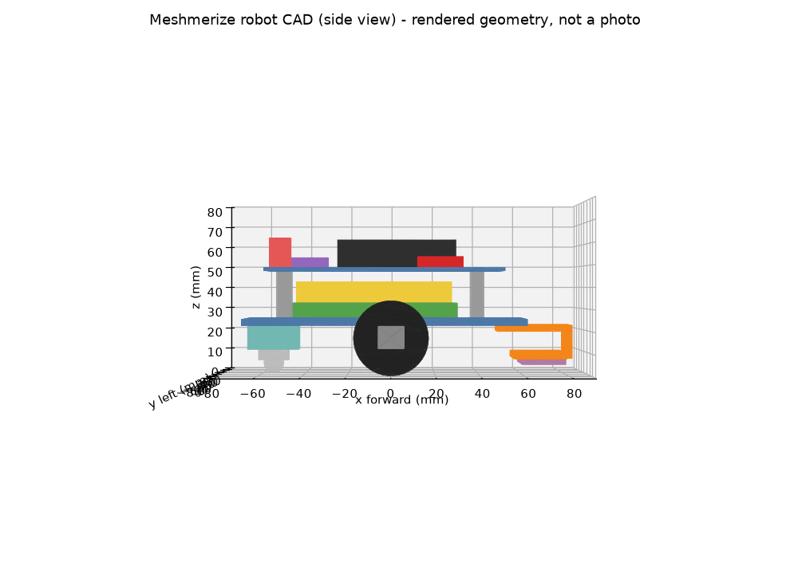

# Mechanical design

## The robot being built (purchased 2WD chassis kit)
| Item | Value | Config parameter |
|---|---|---|
| Drive wheels | 65 mm BO wheels, track ~135 mm (**measure**) | `wheel_diameter_mm`, `track_width_mm` |
| Motors | 2 × BO 500 RPM, no encoders (kit brackets) | `encoder_mode = 2` |
| Rear support | kit caster | — |
| Line array | 5-ch TCRT5000, 15 mm pitch, sensor line **100 mm ahead of the axle**, 5-10 mm above the floor | `sensor_forward_mm`, `sensor_pitch_mm` |
| Wing sensors | 2 × FC-51 pointing down, ±45 mm from the centreline, level with the array | `wing_lateral_mm` |
| Battery | 4 × 18650 holder, strapped over or just ahead of the axle | — |
| Gyro | MPU6050 flat near the middle, on foam tape | — |
| Envelope | must stay inside 220 × 220 × 220 mm **including the sensor bracket** (simulator assumes 115 mm axle-to-front, 95 mm axle-to-rear: measure) | — |

Build steps: `docs/assembly_guide.md`. Whether a purchased chassis plate counts as a "ready-made
mechanism" (rule p.5) is an open question for the organisers; a self-made plate of the same size
is the fallback.

The sensor distance study below was done on the original robot; from 55 mm upwards results were
flat, and the BO robot is tuned and benchmarked at 100 mm.

## Original design (N20, kept as the parametric CAD)
Editable parametric CAD: `hardware/cad/robot_cad.py` (CadQuery 2.8). Running it regenerates every
STEP/STL file, the drawings, and an automated fit report. Renders: `docs/images/robot_*.png`.
The simulator reproduces this robot with the `n20_hardware()` preset.

### Layout (x forward, y left, z up, origin on the floor under the axle)
| Item | Position / size | Reason |
|---|---|---|
| Drive wheels | Ø34 × 7 mm, track **96 mm**, axle at x = 0, z = 17 | small diameter keeps the sensor bracket short and the CoM low |
| Motors | N20 under the plate, gearbox faces outward, clamped by printed U-clamps (2 × M2 each) | the clamps take the load off the plate; easy to swap |
| Chassis plate | 130 × 82 × 3 mm, underside at z = 22.5 | inside the wheels (3.5 mm lateral clearance) |
| Rear support | ball caster at x = −55, contact at z = 0 (level checked in CAD) | low friction; a metal ball cannot mark vinyl |
| Sensor array | QTR-MD-08A, sensor line **70 mm ahead of the axle**, 4.5 mm above the floor | see the analysis below |
| Battery | 2S 1000 mAh in a tray **over the axle**, velcro strap through the plate | CoM near the axle, so the drive wheels carry most of the weight (traction for braking and pivots) |
| Electronics deck | 110 × 74 mm on four 22 mm M3 standoffs | ESP32, TB6612 and buck reachable from above without removing anything |
| Red LED | 5 mm, on a tower at the rear of the deck | visible to the referee from behind and above |

**Envelope:** 151.5 × 106 × 63 mm (rule: 220 mm cube) · **estimated mass:** ≈ 180 g.

### Automated checks (`hardware/assembly_drawings/fit_report.md`)
* fits 220³; footprint near 150 × 140;
* track width and sensor distance match `config.h` (also unit-tested in `test_consistency.py`);
* sensor height 3–6 mm;
* ground clearance ≥ 3 mm for everything except the wheels and caster ball;
* chassis level (caster and wheel contact both at z = 0);
* plate clears the wheels;
* battery clears the deck;
* no unexpected solid overlap between any two parts (expected overlaps: motor shaft in the wheel
  hub, parts bolted together).

These are **rendered-geometry checks**. They do not replace measuring the purchased parts and test-fitting printed ones.

### Sensor-to-axle distance Ls as a control parameter
* **Look-ahead (line following).** A sensor ahead of the axle measures the lateral error at a point
  the robot will reach later. That adds phase lead and lets higher gains stay stable. Too long a
  lever, though, makes the reading swing with every small heading change (gain ∝ Ls).
* **Junction handling.** The junction is classified when the array has crossed it. The axle is then
  still about Ls − 15 − 20 mm short of the centre. That is the **braking distance**
  available before a pivot: about 35 mm at Ls = 70 mm. At the 0.45 m/s exploration speed
  and 3 m/s² braking, the robot needs 34 mm. A shorter Ls forces slower exploration or
  overshoot; a longer one lengthens the robot.
* **Turn capture.** During a pivot the array sweeps an arc of radius Ls, so a bigger
  Ls gives more angular resolution at capture (1 mm ≈ 0.8° at 70 mm). But the array is
  then further from the line at mid-turn.
* **Measured in simulation** (40 random mazes + the sample, realistic profile, default policy;
  the 70 mm row is the 101-arena `final_real` set):

  | Ls | dry-run completion | shortest path | restarts | mean score |
  |---|---|---|---|---|
  | 40 mm | **54 %** | 12 % | 89 | 141 |
  | 55 mm | 100 % | 100 % | 0 | 411.5 |
  | **70 mm (design)** | 100 % | 99 % | 0 | 413.0 |
  | 90 mm | 100 % | 100 % | 0 | 415.0 |

  Below roughly 50 mm the robot cannot finish classifying a junction and still stop on its centre
  at exploration speed. Turns then start too late and the line is lost (70 line-loss events and 89
  restarts at 40 mm). From 55 mm up, performance is flat within noise. **70 mm** keeps a ~15 mm
  safety margin over the threshold. 90 mm is marginally better but makes the robot 20 mm longer.
  If the real robot shows late turns, lengthen the bracket rather than slowing everything down.

### Rear support
A ball caster was chosen over a skid: lower friction in pivots, and no risk of scuffing the vinyl.
If a 3/8" caster sits at the wrong height, set `caster_h` in the CAD and reprint the mount. The
check "chassis level" must pass.

### Fasteners
M2 for motor clamps, the caster mount and the sensor bracket. M3 nylon standoffs for the deck.
Self-tapping into PETG is acceptable for M2 at the motor clamps. Use heat-set inserts if parts are
removed often.
