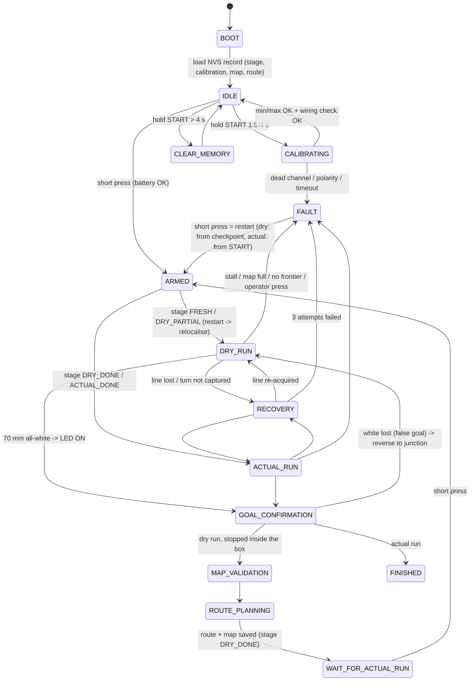

# System architecture

## Block diagram
```
 ┌──────────── robot (ESP32) ─────────────┐        ┌──────────── PC simulator ────────────┐
 │ main.cpp  1 kHz loop, watchdog, NVS    │        │ Python: arena, physics, IR model,    │
 │ hal_esp32: ADC, I2C gyro, LEDC, GPIO   │        │ gyro, battery, referee, scoring      │
 │        │ HalInputs      ▲ HalOutputs   │        │        │ HalInputs      ▲ HalOutputs  │
 │        ▼                │              │        │        ▼   (ctypes)     │             │
 │  ┌──────────────── mesh::Robot ──────────────────────────────────────────────┐          │
 │  │ sensors/line_sensor   calibration, normalisation, line position, branch   │  SAME    │
 │  │ encoders/odometry     distance s, heading (gyro), wheel speeds / model    │  C++     │
 │  │ motion/motion_controller  FOLLOW (PD + speed profile), STRAIGHT, PIVOT,   │  CODE    │
 │  │                           BRAKE, wheel PI + battery feed-forward          │          │
 │  │ maze/junction_detector + goal_detection/goal_detector  -> track events    │          │
 │  │ maze/graph            nodes, edges, matching, validation, rollback        │          │
 │  │ exploration/explorer  DFS / frontier / wall-follow policies               │          │
 │  │ exploration/relocalizer  anchored + free re-joining after restarts        │          │
 │  │ planner/planner       Dijkstra on (node, heading), frontier search, bound │          │
 │  │ persistence/storage   CRC'd blob: stage, calibration, map, route          │          │
 │  │ safety/fault_monitor  stall, battery                                      │          │
 │  │ app/robot             competition state machine, navigation, recovery     │          │
 │  └───────────────────────────────────────────────────────────────────────────┘          │
 └────────────────────────────────────────┘        └──────────────────────────────────────┘
```
All parameters are in `firmware/include/config.h` (an X-macro table). The simulator can change
any of them by name.

## Competition state machine

Any press while the robot is moving is an **operator stop**: the motors switch off immediately.

## Timing (justification)
| Item | Value | Why |
|---|---|---|
| Sensor sampling and control loop | **1 kHz** | At 1 m/s the robot moves 1 mm per sample, so a 30 mm cross line gives 30 samples. Nine ADC reads (twice each) take ~0.2 ms on a 240 MHz ESP32. |
| Motor PWM | 1 kHz (L298N build) / 20 kHz (TB6612, DRV8833), 10-bit | the L298N switches slowly; MOSFET drivers allow inaudible PWM |
| Wheel motion | no encoders (purchased BO motors): first-order speed model of the commanded wheel speeds; heading from the MPU6050 gyro read every 1 ms, bias re-estimated whenever the robot stands still for 300 ms. Optional slot encoders: one interrupt per slot edge | the gyro gives turn angles to about 1 % (scale error) without wheel feedback |
| Motor balance | no encoders: left/right trim learned from the steady line-follow steering on straights (time constant 1.5 s) | two BO motors differ by 10-15 % |
| Junction debounce | 2 consecutive samples of the branch pattern; crossing ends after 4 mm clear; 16 mm look-ahead for a straight exit | distance-based, so independent of speed |
| Dead end | line absent for 14 mm while the line was last seen centred | |
| Line lost | line absent for 14 mm while last seen at the array edge (> 24 mm), then recovery sweep ±70° | |
| Turn completion | gyro angle past 55° (150° for U-turns), then line centred within max(7 mm, 0.6 × sensor pitch); failure if 40° overshoot | a line wider than the 15 mm pitch makes a digital array jump between ±7.5 mm |
| Goal confirmation | 70 mm continuous white, then 140 mm confirmation drive | see ADR-7 |
| Acceleration | dry run 2.5 m/s² up, 3.0 m/s² braking; actual run 3.5 / 3.5 m/s² | must stop within ~40 mm after a junction is classified at exploration speed |
| Stall | with encoders: commanded motion, no wheel motion for 450 ms. Without: 3200 mm of modelled travel with no junction, corner or dead end (arena 2.3 m) | protects the driver and the arena |
| Watchdog | 1 s task WDT | a hung loop resets the MCU; STBY pull-down stops the motors |

## Data flow per 1 ms step
`HalInputs → odometry.update → line_sensor.process (features) → button → state machine
(detector events → map/explorer/planner decisions → motion commands) → motion_controller.update →
wheel PI → HalOutputs (duty, LEDs, save request)`.

## Memory
* RAM: map (96 nodes, 160 edges), a copy of the old map during relocalisation, route, logger:
  ≈ 30 KB static. The ESP32 build uses 21 % of RAM and 26 % of flash.
* No heap in the core.
